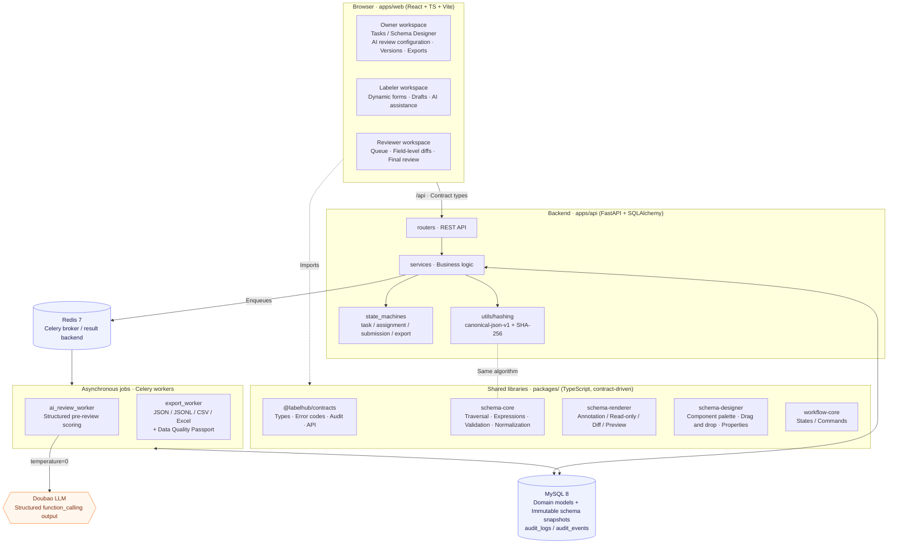
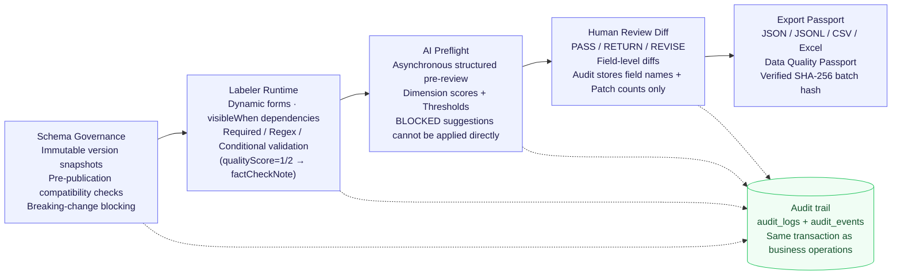
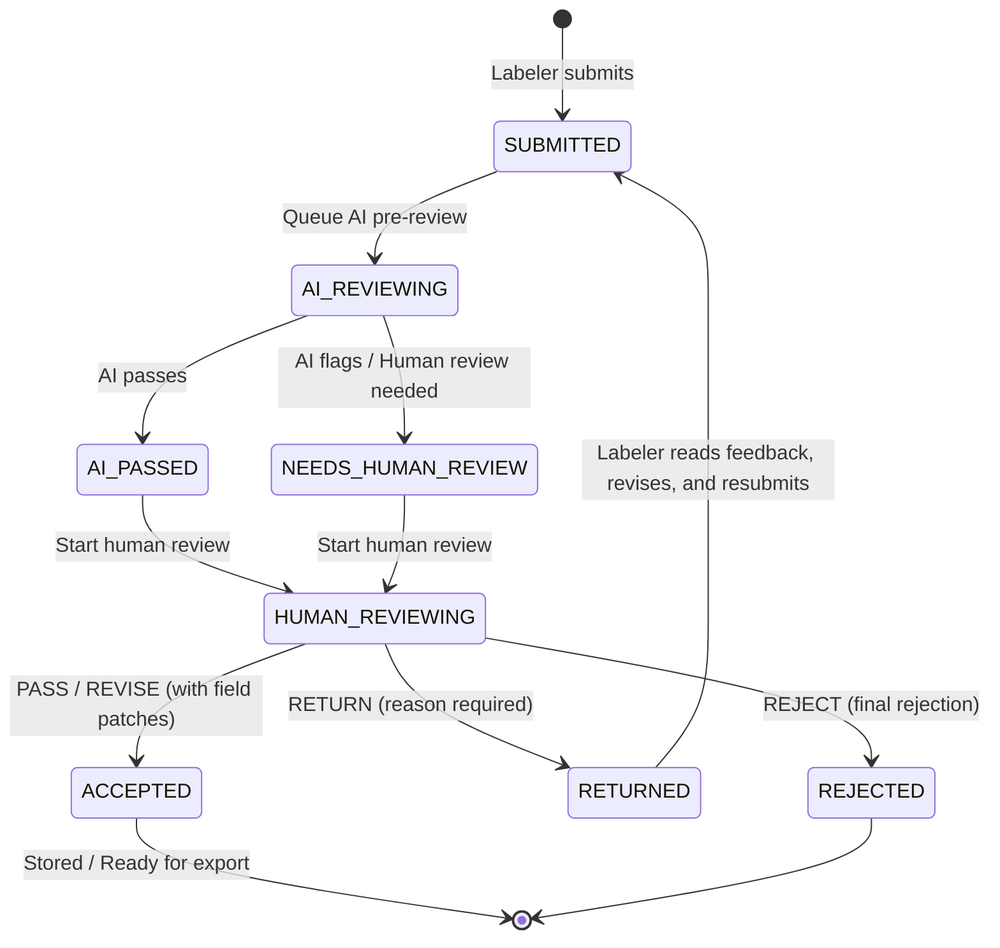

# LabelHub

**LabelHub is a schema-driven platform for AI data annotation and quality governance.**

[](https://github.com/peilinpeng/labelhub/actions/workflows/web-ci.yml)
[](https://github.com/peilinpeng/labelhub/actions/workflows/api-ci.yml)
[](https://github.com/peilinpeng/labelhub/actions/workflows/web-e2e.yml)

LabelHub supports three roles—Owner, Labeler, and Reviewer—across task configuration, schema template design, dynamic annotation, AI-assisted quality checks, human review, audit trails, and quality-aware exports. The entire system follows shared contracts: versioned schemas define annotation structures, validation constrains AI assistance, and quality decisions remain traceable throughout the workflow.

> Monorepo layout: `apps/web` (frontend), `apps/api` (backend API and Celery workers), and `packages/*` (shared contracts, schema-core, schema-compiler, schema-renderer, schema-designer, and workflow-core libraries). See [`docs/PROJECT_STATUS.md`](./docs/PROJECT_STATUS.md) for the current mainline baseline, validation snapshot, and maintenance backlog.

---

## 0. Requirements Coverage (4.1–4.6 and Acceptance Criteria)

> A feature-completeness checklist for project evaluation. Each row maps a core requirement to its implementation and demo entry point.

| Requirement | Implementation | Code / Demo Entry Point |
| --- | --- | --- |
| **4.1 Task management**: lifecycle states (draft / published / paused / ended), rich-text instructions, tags, rewards, quotas, deadlines, and distribution policies | ✅ `DRAFT/PUBLISHED/PAUSED/ENDED/ARCHIVED` state machine; **all three distribution policies implemented: first come, first served / assignment / quota-based claiming** (the requirement only asks for one) | `apps/api/app/models/task.py`, `schemas/task.py`; `/owner/tasks` |
| Dataset import and preview: **JSON / JSONL / Excel** | ✅ All three import formats, with item previews | `apps/api/app/routers/dataset.py`; `/owner/tasks/:id/dataset` |
| **4.2 Dynamic form Designer/Renderer** (core challenge): component palette → canvas → property panel, serializable JSON schemas, and shared rendering between Designer and Labeler | ✅ Decoupled Designer / Renderer; components include single-line and multiline text, single and multiple choice, tags, rich text, file/image uploads, a JSON editor, LLM interaction, and ShowItem | `packages/schema-designer`, `packages/schema-renderer`; `/owner/tasks/:id/designer` |
| Advanced features: field dependencies, custom validation, grouped containers, and multiple tabs | ✅ `visibleWhen/disabledWhen/linkageRules` compile into Formily reactions; required / length / regex / custom validation; tabbed container layouts | `packages/schema-compiler`, `packages/schema-renderer` |
| **4.3 Labeler workspace**: task marketplace, annotation, draft autosave, submission validation, item-level LLM assistance, and personal submissions | ✅ Searchable and filterable task cards; **claim-based queue** (claim one item at a time, then return to the marketplace after submission); debounced draft autosave; runtime validation; item-level LLM assistance; submission status summaries | `apps/web/src/features/labeler`; `/labeler/tasks`, `/labeler/workspace/:id`, `/labeler/submissions` |
| **4.4 AI pre-review agent** (core challenge): configurable prompts and scoring dimensions, asynchronous queues, structured Function Calling output, retries and idempotency, and visible, traceable results | ✅ Configurable dimensions / thresholds / weights; Celery queue; `FUNCTION_CALLING` structured output rather than raw-text parsing; `retry_count` and idempotency keys; AI feedback and the original prompt available in the review workspace | `apps/api/app/services/review_domain.py`, `worker/ai_review_worker.py`; `/owner/ai-config` |
| **4.5 Multi-role review workflow**: `PASS/RETURN/REVISE` decisions, auditable transitions, batch operations, required return reasons, previous-round feedback, and round-to-round diffs | ✅ Structured decisions; batch review via `BatchReviewRequest`; required reasons for `RETURN`, with previous feedback visible to Labelers; field-level diff auditing via `REVIEW_DIFF_GENERATED` | `apps/api/app/routers/review.py`, `services/review_domain.py`; `/reviewer/items` |
| **4.6 Multi-format export**: JSON / JSONL / CSV / Excel, asynchronous exports, download history, and configurable field mapping | ✅ All four formats generated; Celery export jobs; field selection / renaming / optional review records | `apps/api/app/worker/export_worker.py`, `services/export_domain.py`; `/owner/tasks/:id/export` |
| **Engineering quality (25%)**: TypeScript typing, unit/integration tests, README, and deployment documentation | ✅ `@labelhub/contracts` as the single source of shared types, without widespread `any`; shared packages, API, Web, and real-backend E2E covered by GitHub Actions; dated test counts and coverage in the project status page | [`docs/PROJECT_STATUS.md`](./docs/PROJECT_STATUS.md), `docs/deployment.md` |
| **Product experience (15%)**: consistent visuals, helpful errors, reversible actions, and support for 1280×800 and 1920×1080 | ✅ Draft autosave and reversible actions; plain-language errors; responsive layouts with 70+ media queries (mobile support is an additional feature) | — |

> See [`submission/README.md`](./submission/README.md) for the **presentation deliverables checklist**: source monorepo, demo video, architecture diagram, AI coding log, screenshots, accessible demo environment details, and API documentation.

---

## 1. Problems LabelHub Addresses

Data annotation workflows repeatedly encounter three challenges:

1. **How can annotation structures be configured for different tasks?** Fields, choices, required values, and dependencies vary by task; hardcoded forms are difficult to reuse.
2. **How can AI contribute to quality checks while respecting validation rules?** Allowing AI suggestions to overwrite human answers directly undermines data reliability and schema constraints.
3. **How can quality decisions and review evidence be traced before delivery?** Delivered data should explain why an item passed, who reviewed it, and what the AI suggested.

LabelHub addresses these challenges through:

1. **Schema Governance** — versioned, governed dynamic annotation structures.
2. **AI suggestedPatch + preflight** — field-level AI suggestions that must pass deterministic checks before application.
3. **Quality Evidence Chain** — audit records, AI pre-review, human decisions, and export passports that make quality evidence traceable.

---

## 2. Key Features

- **Three-role workflow**: Owners, Labelers, and Reviewers collaborate on the same tasks and submissions.
- **Schema-driven dynamic forms**: annotation pages render from versioned schemas at runtime.
- **Schema Version Management**: immutable published snapshots, version history, compatibility checks, breaking-change blocking, history-preserving rollback, and migration-required previews.
- **AI Assist**: field-level `suggestedPatch` with deterministic `preflight` checks (`SAFE / WARNING / BLOCKED`).
- **Reviewer decision flow**: structured `PASS / RETURN / REVISE` decisions; `RETURN` requires a reason, and `REVISE` records field-level patches.
- **Quality governance tools**: Quality Center, Audit Trail, and Export Passport (Data Quality Passport).
- **AI Review configuration**: configurable prompts, scoring dimensions, and thresholds, with sliders that automatically normalize weights to sum to 1.

> **Capability boundaries**: historical-data migration supports fixed inputs, persisted dry runs, independent approval, background execution, and immutable outputs. Original submissions remain unchanged. Task permissions, publication checks, and per-batch limits still apply; see the [governance guide](docs/GOVERNANCE.md).

---

## 3. System Architecture

LabelHub uses a full-stack monorepo architecture. Three browser workspaces (`apps/web`) access the backend (`apps/api`) through a **contract-defined REST API**. The backend delegates time-consuming AI pre-review and export jobs to **Celery workers**. Shared types, schema logic, and rendering capabilities live in `packages/*`, with the frontend, backend, workers, and tests aligned to **the same contracts**.

### 3.1 Overview



> This English diagram is rendered directly from the Mermaid source above. The original presentation assets remain available in [`submission/architecture.mmd`](submission/architecture.mmd) and [`submission/architecture.png`](submission/architecture.png).

### 3.2 Layer Responsibilities

| Layer | Module | Responsibilities |
| --- | --- | --- |
| Frontend | `apps/web` (React 19 + TS + Vite) | Owner / Labeler / Reviewer workspaces; annotation pages rendered from versioned schemas at runtime |
| Backend API | `apps/api` (FastAPI + SQLAlchemy) | REST routes → domain services → **command-driven state machines**; `canonical-json-v1 + SHA-256` hashing |
| Background workers | `apps/api/app/worker` (Celery) | Structured AI scoring via `ai_review_worker`; multi-format exports and Data Quality Passports via `export_worker`; shared image with the API |
| Shared contracts | `@labelhub/contracts` | **Single source of shared types** for frontend / backend / workers / mocks / tests: states, error codes, audit events, and API shapes |
| Schema core | `@labelhub/schema-core` | Deterministic pure functions for traversal, expressions, validation, normalization, compatibility, and version freezing; no database access |
| Rendering | `@labelhub/schema-renderer` | Dynamic form runtime and AI preflight; annotation / read-only / diff / preview modes |
| Designer | `@labelhub/schema-designer` | Owner-side component palette, drag and drop, properties, validation, and field dependency configuration |
| Compilation / workflow | `@labelhub/schema-compiler`, `workflow-core` | Schema-to-Formily-reaction compilation; states and commands |
| Storage | MySQL 8 / Redis 7 | Domain models, immutable schema snapshots, and `audit_logs/audit_events`; Celery broker and result backend |
| LLM | Doubao LLM | Structured `function_calling` output; `temperature=0` for more stable scoring |

> **MSW mock layer** (`apps/web/src/mocks`): the real backend is implemented. MSW supports isolated frontend development, component tests, and demos without Docker, reusing contract types rather than redefining them.

### 3.3 Technology Stack

| Area | Technologies |
| --- | --- |
| Frontend | React 19, TypeScript 7, Vite 8, Formily runtime |
| Backend | Python 3.11, FastAPI, SQLAlchemy, Alembic, Pydantic |
| Background jobs / queues | Celery + Redis 7 |
| Database | MySQL 8 |
| LLM | Doubao (OpenAI-compatible, with function calling) |
| Testing | `node:test` (shared libraries), Vitest / RTL (Web), pytest (backend), E2E scripts |

### 3.4 End-to-End Data Quality Flow

The design follows this sequence: **trusted structures → runtime validation → AI constrained by rules → recorded human decisions → delivery with quality evidence**.



```txt
Schema Governance → Labeler Runtime → AI Preflight → Human Review Diff → Export Passport
       └──── audit_logs / audit_events recorded throughout, in the same business transaction ────┘
```

### 3.5 Review Workflow State Machine (Requirement 4.5)

Submission transitions are traceable throughout the workflow. Each transition and its audit record are written **in the same transaction**:



> **Decision semantics**: the Reviewer UI offers `PASS / RETURN / REVISE`. `REVISE` means “approve with revisions,” includes field-level patches, and is persisted as `PASS + patches`. The contract-level human decision enum is `PASS / RETURN / REJECT`, where `REJECT` is a final rejection. State values come from the backend `SubmissionStatus`; all transitions are audited.

---

## 4. Repository Structure

```txt
apps/
  web/        Frontend application (React + Vite)
  api/        Backend API (FastAPI); Celery workers use the same image

packages/
  contracts/        Shared types and API contracts (single source of shared types)
  schema-core/      Pure functions for schema versions, compatibility, deprecation, and migration plans
  schema-compiler/  Schema compilation
  schema-renderer/  Runtime renderer and AI preflight
  schema-designer/  Owner-side schema editing tools
  workflow-core/    Core workflow logic

docs/
  Architecture, schema governance, delivery guides, and AI coding records (AI_CODING_PROCESS.md)

submission/
  Presentation deliverables index (submission/README.md)
```

> Workers are Celery processes using the `apps/api` image, not a separate top-level directory. See the `worker` service in `docker-compose.yml`.

---

## 5. Main Modules

### Owner — Task Administration (`apps/web/src/features/owner`)

- Task management and guided task setup
- Dataset import and preview
- Schema Designer
- Schema Version Management: version status, compatibility badges, and publication outcome banners
- AI pre-review configuration: prompts, dimensions, thresholds, and weight sliders
- Quality Center
- Exports and Quality Passports
- Audit timeline

[View screenshot: Owner AI pre-review configuration, normalized dimension weights, and rule preview](submission/screenshots/owner-2-ai-config.png)

### Labeler — Annotation Workspace (`apps/web/src/features/labeler`)

- Task marketplace
- Annotation workspace powered by the dynamic schema runtime
- Draft autosave
- Submission validation
- AI Assist Panel
- Revisions to returned submissions

[View screenshot: Labeler workspace with field dependencies and AI assistance](submission/screenshots/labeler-1-workspace.png)

### Reviewer — Review Workspace (`apps/web/src/features/reviewer`)

- Review queue
- Batch claiming and batch review
- Review details
- `PASS / RETURN / REVISE` decisions: required return reasons and field-level revisions
- AI pre-review results

[View screenshot: Reviewer details and field-level diffs](submission/screenshots/reviewer-2-detail.png)

> The screenshots show the current Chinese-language application UI. See [`submission/screenshots/`](submission/screenshots/) for six key screens across the three roles and their index. This English README does not change the application's interface language.

### Shared Governance Layer (`packages/*`)

- Shared types and contracts
- Dynamic schema runtime
- Compatibility checks
- AI suggestion preflight checks
- Auditing
- Export quality evidence

---

## 6. Local Setup

### Option 1: Docker Compose (Recommended, Includes the Real Backend)

```bash
# 0) Prepare environment variables
cp .env.example .env          # Set DOUBAO_API_KEY / DOUBAO_MODEL as needed

# 1) Build deterministically and start infrastructure first
# Insufficient disk capacity blocks the build; containers and volumes are not deleted automatically
python3 scripts/local-compose.py build --pull
python3 scripts/local-compose.py up -d mysql redis --wait

# 2) Run Alembic migrations and seed repeatable base demo / E2E data
python3 scripts/local-compose.py --profile tools run --rm seed

# 3) Start all applications and wait for health checks
python3 scripts/local-compose.py up -d --wait

# 4) Optional: add competition demo data
python3 scripts/local-compose.py run --rm api python scripts/seed_competition.py
```

Compose includes `web`, `api`, `worker`, `scheduler`, `mysql`, and `redis`. The scheduler periodically removes expired idempotency records.

Open the frontend at `http://localhost:5173/`. The production Web image contains only Nginx and static build artifacts. Nginx proxies same-origin `/api` requests to `api:3000`; container startup neither installs npm dependencies nor runs the Vite development server. MySQL and Redis are exposed only within the Compose network by default.

> **Environment variables**: copy `.env.example` to `.env` and fill in local settings. **Never commit real API keys, tokens, or secrets.**

Production deployments must explicitly configure `APP_ENV=production`, `DEMO_MODE=false`, a random `JWT_SECRET` of at least 32 characters, non-default database passwords, `LOGIN_RATE_LIMIT_BACKEND=redis`, and the actual `TRUSTED_HOSTS`. The API fails at startup if any required security condition is unmet. Production frontend builds must set `VITE_DEMO_MODE=false` so the login page neither displays nor prefills demo accounts.

### Option 2: Local Frontend and Shared-Library Development

The project uses Node `26.13.0` and npm `11.20.0`. If nvm is installed, run `nvm use` to load the version from the root `.nvmrc`.

```bash
# Switch to the project's Node version
nvm use

# Install and check shared libraries (packages/*)
npm ci
npm run typecheck
npm run test

# Frontend application (apps/web is a separate npm project)
cd apps/web
npm ci
npm run dev          # Vite development server
```

For a frontend-only demo without the backend, explicitly enable MSW mocks. Run this from the repository root:

```bash
VITE_ENABLE_MSW=true VITE_DEMO_MODE=true \
  npm --prefix apps/web run dev -- --host 127.0.0.1 --port 5180
```

See [`docs/environment-variables.md`](./docs/environment-variables.md) for the full environment-variable reference.

---

## 7. Testing and Validation Commands

```bash
# Shared libraries: check all root workspaces (contracts / schema-core / schema-compiler /
# schema-renderer / schema-designer / workflow-core)
npm run typecheck
npm run test

# Run tests for an individual shared library
npm run test:contracts
npm run test:schema-core
npm run test:schema-renderer

# Frontend application
cd apps/web
npm run typecheck
npm run test:run
npm run build
cd ../..

# Real-backend E2E (install Chromium before the first run)
npm --prefix apps/web exec playwright install chromium
python3 scripts/local-compose.py up -d --build --wait
python3 scripts/local-compose.py --profile tools run --rm seed
npm --prefix apps/web run e2e

# Build the shared migration engine used by the API (requires Node 26)
npm run build:migration-engine

# Backend (production images exclude test dependencies; use hash-locked dependencies in a Python 3.11 venv)
cd apps/api
python3.11 -m venv .venv
.venv/bin/python -m pip install --require-hashes -r requirements-dev.txt
.venv/bin/python -m pytest -m "not integration" -q
cd ../..

# Production dependency vulnerability checks
npm audit --omit=dev --audit-level=high
npm --prefix apps/web run audit:production

# Check whitespace errors and conflict markers before delivery
git diff --check
```

---

## 8. Demo Accounts and Routes

Demo accounts are provided by seed / mock data. The login page also offers role shortcuts to the corresponding workspaces.

| Role | Account | Password |
| --- | --- | --- |
| Owner | `owner@labelhub.com` | `password123` |
| Labeler | `labeler@labelhub.com` | `password123` |
| Reviewer | `reviewer@labelhub.com` | `password123` |

Available demo routes (from `apps/web/src/app/routes.tsx`):

```txt
Owner:
- /owner/tasks                                            Task management
- /owner/ai-config                                        AI pre-review rules, including weight sliders
- /owner/quality                                          Quality Center
- /owner/tasks/:taskId/designer                            Schema Designer
- /owner/tasks/:taskId/dataset                             Dataset
- /owner/tasks/:taskId/export                              Exports

  Schema Governance demo tasks (mock):
- /owner/tasks/task_demo_schema_breaking_change/designer
- /owner/tasks/task_demo_schema_migration_required/designer
- /owner/tasks/task_demo_schema_deprecation/designer
- /owner/tasks/task_demo_schema_safe_publish/designer

Labeler:
- /labeler/tasks                                          Task marketplace
- /labeler/workspace/asn_1001                              Annotation workspace
- /labeler/submissions                                    My submissions

Reviewer:
- /reviewer/items                                         Review queue
- /reviewer/items/:submissionId                           Review details
```

---

## 9. Key Design Decisions

### 9.1 Contract-First Development

Shared contracts are defined in `packages/contracts`, and consumers use `@labelhub/contracts`. This avoids duplicate definitions of status codes, review decisions, and API shapes, keeping the frontend, backend, workers, and mocks aligned on the same concepts.

### 9.2 Schema-Driven Runtime

Annotation pages are generated dynamically from versioned schemas. Field visibility, required values, and validation rules are evaluated at runtime by `packages/schema-renderer` and `packages/schema-core`.

### 9.3 Schema Version Freeze

Published schemas are immutable snapshots. Historical tasks and submissions remain bound to their original `schemaVersionId`, preventing later template edits from invalidating historical data. The core principle is no migration by default: every change must be identifiable, and every migration must leave a trace.

### 9.4 AI as a Governed Suggestion Provider

AI-generated `suggestedPatch` values cannot overwrite answers directly. They must first pass deterministic preflight checks for field existence, newly missing required values, and schema runtime dependencies. Blocked suggestions can be explained and dismissed, but are never silently applied.

### 9.5 Human Review as a Decision Flow

Review is a structured `PASS / RETURN / REVISE` decision flow. `RETURN` requires a reason; `REVISE` records field-level patches.

### 9.6 Quality Evidence Chain

Audits, AI prechecks, reviewer decisions, and Export Passports form a traceable evidence chain, allowing delivered data to be linked back to its quality checks and review process.

### 9.7 Verified Migration Execution

Historical-data migration reuses the planning, dry-run, and execution rules in `schema-core`. The backend persists fixed inputs and SHA-256 digests. After approval by a different authorized user, a worker generates separate, immutable migration outputs. Original submissions and published versions remain unchanged. Source-data changes are recorded as conflicts; approval and publication gates cannot be bypassed. See the [governance guide](./docs/GOVERNANCE.md) for the workflow and limits.

---

## 10. Current Implementation Status

### Completed

- Owner / Labeler / Reviewer workflows
- Dynamic Schema Designer and runtime
- Schema Version Management UI
- Version history and immutable snapshots
- Compatibility checks and breaking-change blocking
- Labeler / Reviewer AI Assist preflight
- Reviewer decision flow (`PASS / RETURN / REVISE`)
- Quality Center / Export Passport / Audit
- AI Review configuration with automatically normalized weight sliders
- Batch migration of historical submissions: dry runs, independent approval, background execution, conflict detection, and immutable results
- Task-level action authorization: allow / deny, expiry, revocation, server-side enforcement, and auditing
- Runtime Trace Panel, field dependency graph, worker compilation, and bounded caching
- Repository-managed Prometheus / Alertmanager / Grafana deployment configuration and automated acceptance checks

### Deployment Boundaries and Optional Extensions

- GitHub Pages provides an in-browser mock demo. Persistent migration requires the real API, MySQL, Redis, workers, and scheduler.
- Monitoring uses a local alert receiver by default. Production endpoints and notification channels must be configured for the target environment; no unspecified production environment is connected.
- Deeper quality analytics and AI audit summaries remain optional future extensions and have not been delivered as product capabilities.

---

## 11. Related Documentation

The linked project documents retain their existing language.

| Document | Purpose |
| --- | --- |
| [docs/GOVERNANCE.md](./docs/GOVERNANCE.md) | Historical-data migration, independent approval, task permissions, and runtime diagnostics |
| [docs/OBSERVABILITY.md](./docs/OBSERVABILITY.md) | Monitoring deployment, metrics, alerts, and recovery |
| [docs/PROJECT_STATUS.md](./docs/PROJECT_STATUS.md) | Current mainline baseline, validation snapshot, capability boundaries, and maintenance backlog |
| [labelhub-architecture-contract.md](./labelhub-architecture-contract.md) | Top-level architecture contract (v1.1), shared across all layers |
| [AI_CODING_RULES.md](./AI_CODING_RULES.md) | AI coding rules: contract-driven development, prohibited actions, and validation requirements |
| [docs/LabelHub_Final_Delivery.md](./docs/LabelHub_Final_Delivery.md) | Final delivery notes |
| [docs/LabelHub_Delivery_Runbook.md](./docs/LabelHub_Delivery_Runbook.md) | Delivery and deployment runbook |
| [docs/environment-variables.md](./docs/environment-variables.md) | Required environment variables, defaults, and sensitivity levels |
| [docs/LabelHub_Schema_Version_Management.md](./docs/LabelHub_Schema_Version_Management.md) | Schema version management specification |
| [docs/AI_CODING_PROCESS.md](./docs/AI_CODING_PROCESS.md) | AI coding process and development records |
| [submission/README.md](./submission/README.md) | Presentation deliverables index |

---

## 12. Security Notes

- Never commit API keys, tokens, or secrets.
- Never expose private LLM provider credentials.
- Manage secrets in a local `.env` file; see `.env.example`.
- Demo seeding is allowed only in non-production environments with `DEMO_MODE=true`; it must not be enabled in production.
- File uploads validate configured limits, actual size, extension, MIME type, content signature, and SHA-256. Configure limits through `MAX_UPLOAD_SIZE_BYTES` and file allowlists.
- Environment variables control JWT lifetime, failed-login rate limits, trusted hosts, and HSTS. Production login rate limiting must use Redis.

---

## 13. Delivery Notes

- `main` is the stable delivery branch. Do not develop on or push directly to `main`.
- Git tags and mainline commits identify reproducible product snapshots. The historical presentation tag `final-delivery-0610` is retained.
- Private npm workspace versions and the OpenAPI service version use separate namespaces. See the project status page for current values and their meaning.

See [local storage maintenance](docs/LOCAL_STORAGE_MAINTENANCE.md) for disk-capacity protection, backups to a separate disk, and restore verification. Run `npm run check:docs` to check documentation consistency.
